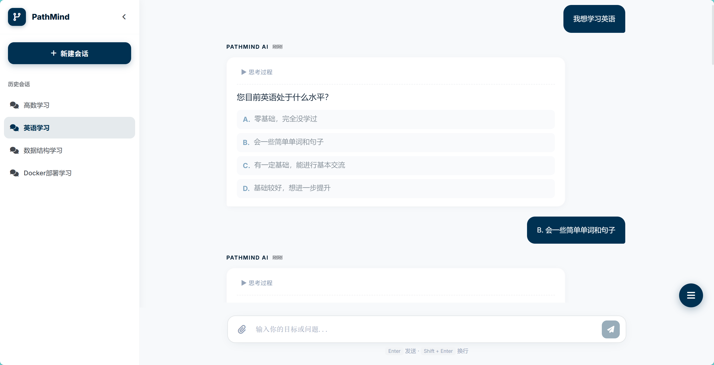
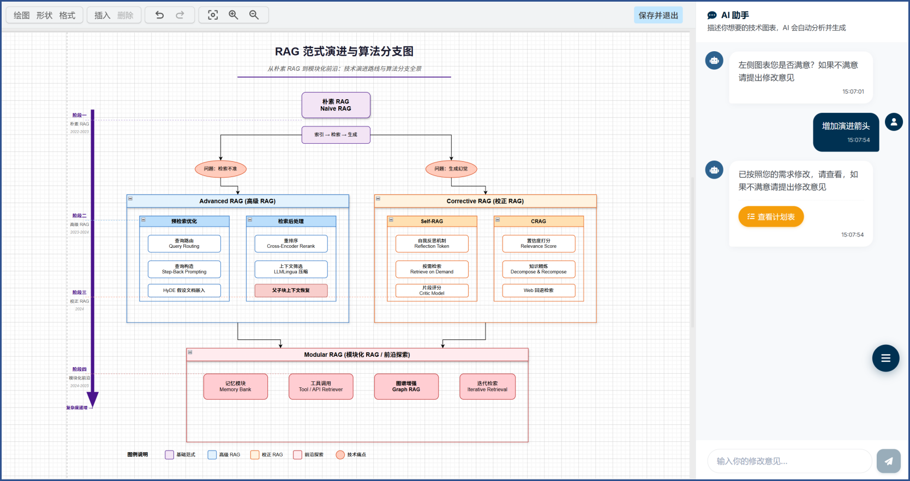
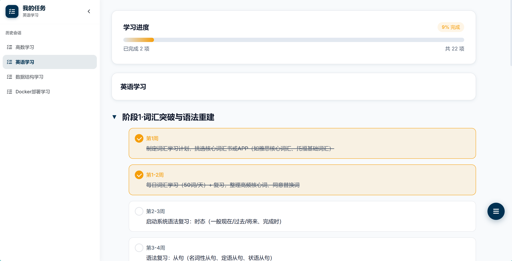
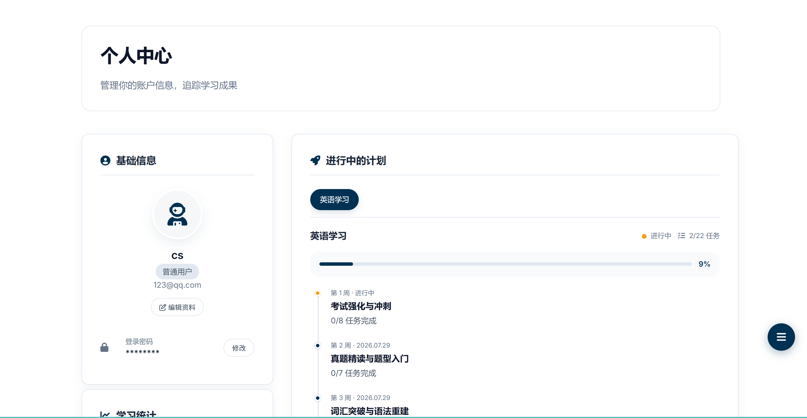
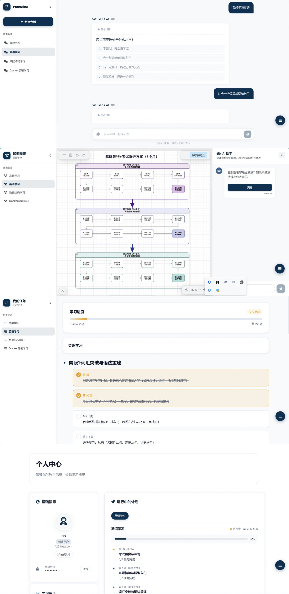

# PathMind · AI 技术选型与学习路径规划平台

> 从一个目标出发，让技术选择有依据，让学习计划可执行。

> **在线项目说明：** 因服务器到期，暂时无法查看在线项目，近期将完善并重新上线。

## 项目简介

PathMind 是一个 AI 技术选型与学习路径规划平台，通过目标问答、方案对比、知识图谱和任务管理，帮助用户制定计划、跟踪学习进度。本仓库为基于 **React + TypeScript + Vite + SCSS** 构建的前端项目。

```text
描述目标 → 多轮问答 → 方案对比 → 生成学习图谱 → 创建任务日程 → 学习与进度追踪
```

## 主要功能

| 功能模块 | 功能介绍 |
| --- | --- |
| AI Copilot | 通过多轮问答明确目标，支持历史会话管理。 |
| 技术方案对比 | 对比方案的优点、风险、成本和难度，提供推荐理由。 |
| 知识图谱 | 展示学习路线与阶段关系，支持 AI 调整和生成日程。 |
| 任务中心 | 按阶段查看任务、勾选完成并跟踪学习进度。 |
| 任务学习助手 | 围绕当前任务拆解步骤、推荐资料和设计练习。 |
| 知识库管理 | 管理知识库与文档，支持文件上传和拖拽上传。 |
| 个人中心 | 管理账户资料，查看学习统计、计划和成就。 |
| 账户与权限 | 支持注册、登录和业务页面访问保护。 |

## 项目亮点

- **流程连贯**：从目标咨询到图谱生成、任务执行，在同一会话中持续推进。
- **推荐有依据**：统一维度对比方案，展示推荐理由与决策提示。
- **计划可视化**：用知识图谱展示阶段关系，通过自然语言调整内容。
- **进度可追踪**：实时展示图谱生成状态，记录任务完成情况。
- **多端适配**：统一卡片风格，兼顾桌面与移动端阅读体验。

## 图片简介

### 项目首页

展示平台定位，并提供 AI 咨询与知识图谱入口。


### AI Copilot

通过多轮问答了解学习基础与目标，支持切换历史会话。



### 知识图谱

直观展示知识关系与学习路线，支持通过 AI 助手提出修改意见。



### 任务中心

按阶段管理学习任务，勾选完成并查看整体进度。



### 个人中心

管理账户资料，查看进行中的计划和任务完成情况。



### 完整流程预览

以英语学习为例，展示从目标问答、图谱规划到任务执行和进度查看的流程。



## 技术栈

| 分类 | 技术 |
| --- | --- |
| 构建工具 | Vite 8 |
| 前端框架 | React 19 |
| 路由 | React Router DOM 7 |
| 类型系统 | TypeScript 5 严格模式 |
| 样式 | Sass / SCSS |
| 状态管理 | Zustand 5 |
| HTTP 请求 | Axios |
| 图谱渲染 | react-drawio / draw.io XML |
| 内容渲染 | react-markdown |
| 流式通信 | Fetch / POST SSE |
| PWA | vite-plugin-pwa |

## 快速开始

使用 npm 安装依赖，Node.js 版本需满足当前 Vite 依赖要求：`^20.19.0 || >=22.12.0`。

```bash
npm ci
npm run dev
```

## 常用命令

```bash
npm run dev       # 启动开发服务器
npm run build     # TypeScript 构建检查并打包生产资源
npm run build:prod # 使用 production 模式构建
npm run lint      # ESLint 检查
npm run preview   # 预览生产构建
```

## 路由说明

| 路径 | 页面 | 说明 | 权限 |
| --- | --- | --- | --- |
| `/` | HomePage | 产品首页 | 公开 |
| `/login` | LoginPage | 登录 | 公开，已登录会重定向 |
| `/register` | RegisterPage | 注册 | 公开，已登录会重定向 |
| `/consult` | ConsultPage | AI Copilot 对话规划 | 需登录 |
| `/graph` | GraphPage | 知识图谱与路线图 | 需登录 |
| `/tasks` | TasksPage | 学习任务中心 | 需登录 |
| `/task-detail` | TaskDetailPage | 单个任务学习助手 | 需登录 |
| `/knowledge-base` | KnowledgeBasePage | 知识库与文档管理 | 需登录 |
| `/profile` | ProfilePage | 个人中心 | 需登录 |

## 项目结构

```text
src/
  api/                 # API 请求封装
    axios.ts           # Axios 实例、拦截器、通用 get/post/put/delete
    auth.ts            # 登录、注册、退出和用户信息接口
    conversation.ts    # Copilot 会话、历史记录和目标咨询接口
    graph.ts           # 图谱生成、保存和 AI 修改接口
    sse.ts             # POST SSE 请求与事件解析
    chartStreamProgress.ts # 图谱生成阶段与进度处理
    knowledgeBase.ts   # 知识库和文档接口
    profile.ts         # 个人中心接口
    tasks.ts           # 日程任务接口
  components/
    common/            # Button、Card、ResourceSidebar、ProtectedRoute、ScrollToTop 等
    layout/            # Header、Footer
  assets/img/          # 项目标识与产品预览图
  constants/           # 智能体 ID、存储键等全局常量
  hooks/               # 会话等共享交互逻辑
  pages/
    Auth/              # 登录和注册
    Consult/           # AI Copilot
    Graph/             # 知识图谱和 AI 图谱侧栏
    Home/              # 首页
    KnowledgeBase/     # 知识库管理
    Profile/           # 个人中心
    Tasks/             # 任务中心和任务详情
  routes/              # 路由入口和根布局
  stores/              # Zustand stores
  styles/              # 变量、mixin、动画和全局样式
  types/               # API、图谱、Copilot 等类型
  utils/               # localStorage、ID、draw.io XML 和会话数据工具
```

## 数据流

1. `App.tsx` 启动时调用 `useAuthStore.checkAuth()`，根据本地 token 拉取当前用户。
2. 登录成功后，`authStore` 保存 token 到 `localStorage`，Axios 非白名单请求会自动带上 `Authorization`。
3. Copilot 页面通过 `/api/agent/getSessionList`、`/api/agent/createSession`、`/api/agent/goal` 管理会话和方案对话。
4. Copilot 选中方案后调用 `/api/agent/chartsStream`，接收生成阶段消息；完成后传递会话上下文并跳转 Graph，通过 `/api/agent/getXml` 获取图谱内容。
5. Graph 页面按会话缓存图谱；返回内容包含日程时，将其同步到带会话 ID 的计划缓存键，并支持调用接口创建日程。
6. Tasks 页面按当前会话从后端加载日程并更新缓存；勾选任务时乐观更新本地状态，后端更新失败则回滚。
7. TaskDetail 页面优先调用 `/api/agent/scheduleChat`，失败后使用本地规则生成学习建议。

## 状态管理

| Store | 作用 |
| --- | --- |
| `authStore` | 用户、token、登录态、认证 loading/error，使用 Zustand persist |
| `chatStore` | 图谱 AI 面板消息、当前 session、满意度状态 |
| `graphStore` | 通用图谱数据和 loading 状态 |
| `scheduleStore` | 日程任务列表、当前日程、任务状态同步与失败回滚 |
| `sessionStore` | Copilot、Graph、Tasks 之间共享的当前会话与选项上下文 |
| `profileStore` | 计划、成就、统计数据和拆分 loading 状态 |
| `navStore` | 右侧悬浮导航展开状态，持久化到 `localStorage` |

## 通用组件

新增 UI 前优先复用 `src/components/common`：

- `Button`: 支持 `primary`、`secondary`、`primary-blue`、`text`、`cta-white` 变体。
- `Card`: 支持 `default`、`bordered`、`elevated` 变体和多种 padding。
- `Badge`: 支持默认、主色、强调色、成功、警告、错误状态。
- `Input` / `Textarea`: 支持 label、error 和常用原生属性。
- `EmptyState`: 统一空状态展示，可传入 action。
- `Spin`: 小、中、大三种 loading。
- `ResourceSidebar`: 可折叠资源侧栏，用于 Copilot、Graph、Tasks 和 KnowledgeBase。

## 验证建议

修改代码后建议运行：

```bash
npm run lint
npm run build
```

当前 `package.json` 未提供 `type-check` 或 `test` 脚本，构建命令已包含 TypeScript 构建检查。
